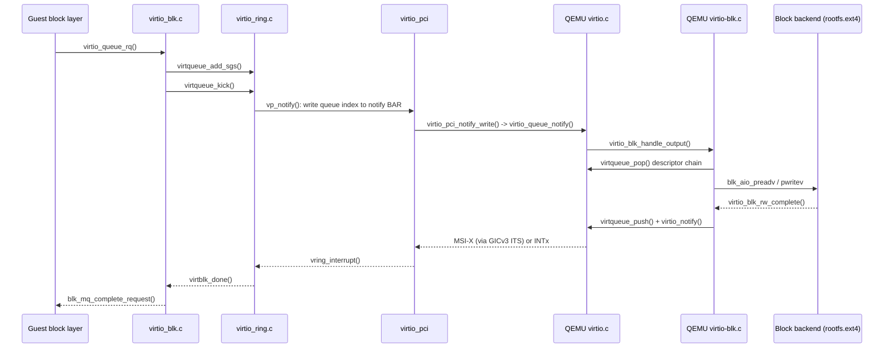

# Virtio Data Flow Cheat Sheet

This lab boots an arm64 guest on the QEMU `virt` machine (GICv3) with the root disk attached as `virtio-blk-pci`. The notes below follow one block request from the Linux guest into QEMU and back.



## 1. Device discovery and initialization

1. The guest enumerates the PCIe host bridge of the `virt` machine and finds a device with vendor ID `0x1af4`. Modern Virtio PCI device IDs are `0x1040 + virtio device ID`, so virtio-blk (ID `2`) appears as `0x1042`.
2. `virtio_pci` walks the vendor-specific PCI capabilities to locate the **common config**, **notify**, **ISR**, and **device-specific config** regions in the BARs.
3. The driver drives the status register through `ACKNOWLEDGE` → `DRIVER` → feature negotiation → `FEATURES_OK`.
4. For each virtqueue it allocates the **descriptor table**, **available ring**, and **used ring**, writes their guest-physical addresses to the common config, and reads `queue_notify_off`. The doorbell address is `notify_base + queue_notify_off * notify_off_multiplier`.
5. The driver sets `DRIVER_OK`; from here on the device may process queues.

## 2. Guest → QEMU (submitting a request)

1. `virtio_blk` turns a block request into a scatter-gather list: a `virtio_blk_outhdr` (type, sector), the data buffers, and a 1-byte status buffer.
2. `virtqueue_add_sgs()` writes those buffers' guest-physical addresses into a chain of descriptors and publishes the chain head in the available ring.
3. `virtqueue_kick()` checks event suppression (`VIRTIO_RING_F_EVENT_IDX` / `NO_NOTIFY`) and, if needed, `vp_notify()` writes the queue index to the notify doorbell.
4. The MMIO write traps into QEMU: `virtio_pci_notify_write()` → `virtio_queue_notify()` → the device's queue handler, `virtio_blk_handle_output()`.

> [!NOTE]
> On Linux/KVM hosts the doorbell is usually delivered through an ioeventfd to an IOThread. On macOS (TCG or HVF) there is no KVM ioeventfd, so the notify is handled synchronously on the vCPU thread — which makes the path easy to step through in a debugger.

## 3. QEMU → guest (completing a request)

1. `virtqueue_pop()` maps the descriptor chain into a `VirtQueueElement`; `virtio-blk` parses the header and issues async I/O to the block backend (`output/guest/rootfs.ext4`).
2. When I/O finishes, `virtio_blk_rw_complete()` writes the status byte, and `virtqueue_push()` adds a used element (descriptor head + bytes written) to the used ring.
3. `virtio_notify()` honors interrupt suppression and raises an MSI-X vector (routed through the GICv3 ITS) or falls back to INTx.
4. In the guest, `vring_interrupt()` invokes the queue callback `virtblk_done()`, which reads the used ring, completes the request, and frees the descriptors.

## 4. Observing the flow in this lab

Inside the guest (log in as `root`):

```sh
ls /sys/bus/virtio/devices/                    # virtio0 ...
cat /sys/bus/virtio/devices/virtio0/device     # 0x0002 = virtio-blk
cat /sys/bus/virtio/devices/virtio0/features   # negotiated feature bits
cat /proc/interrupts | grep virtio             # per-queue interrupt counts
```

From QEMU, enable trace events by adding them to the command in `scripts/run.sh`:

```sh
-trace 'virtio_queue_notify' -trace 'virtqueue_pop' -trace 'virtio_notify' \
-trace 'virtio_blk_handle_read' -trace 'virtio_blk_handle_write' -trace 'virtio_blk_rw_complete'
```

Or open the QEMU monitor with `Ctrl-a c` and run:

```text
info qtree
info virtio                       # lists virtio devices and their QOM paths
info virtio-status <path>         # status, features, and queues of one device
info virtio-queue-status <path> 0 # avail/used indices of queue 0
```

For a debugger, a good first breakpoint is `virtio_queue_notify()`, then follow it into `virtio_blk_handle_output()`.

## 5. Where to read the code

QEMU (`build/qemu/`, v9.2.0):

| File | What to look for |
|---|---|
| `hw/virtio/virtio-pci.c` | PCI capabilities, `virtio_pci_notify_write()`, MSI-X |
| `hw/virtio/virtio.c` | `virtqueue_pop()`, `virtqueue_push()`, `virtio_queue_notify()`, `virtio_notify()` |
| `hw/block/virtio-blk.c` | `virtio_blk_handle_output()`, request parsing, `virtio_blk_rw_complete()` |
| `include/hw/virtio/virtio.h` | `VirtIODevice`, `VirtQueue`, `VirtioDeviceClass` |

Linux (inside the Docker build volume, v6.12):

| File | What to look for |
|---|---|
| `drivers/virtio/virtio_pci_common.c` | `vp_notify()`, interrupt / vector setup |
| `drivers/virtio/virtio_pci_modern.c` | Modern transport: capability parsing, queue setup |
| `drivers/virtio/virtio_ring.c` | Split/packed rings, `virtqueue_add_sgs()`, `virtqueue_kick()`, `vring_interrupt()` |
| `drivers/block/virtio_blk.c` | `virtio_queue_rq()`, `virtblk_done()` |
| `include/uapi/linux/virtio_ids.h` | Assigned virtio device IDs |

## 6. Custom device in this lab

The custom device keeps the Virtio PCI transport and replaces the device model:
- **Virtio ID**: `VIRTIO_ID_CUSTOM 43` (both in Linux driver and QEMU). In modern Virtio-1.0 PCI namespace, this appears as PCI device ID `0x1040 + 43 = 0x106b`.
- **Shared UAPI Protocol Specification**: `include/uapi_virtio_custom.h` acts as the single source of truth for both QEMU hardware and Linux kernel drivers, defining `VIRTIO_ID_CUSTOM 43`, DMA opcodes, descriptors, and config space.
- **QEMU Hardware**: Registers `virtio-custom-device` (virtio-bus) and `virtio-custom-pci` (PCI wrapper). It exposes configuration registers (`write_count`, `dma_transfers`, `dma_bytes`) and handles DMA queue processing in `virtio_custom_handle_output()`.
- **Linux Driver Architecture**:
  - `virtio_custom_main.c`: Bus driver registration, PCI/Virtio probe and remove lifecycle.
  - `virtio_custom_dma.c`: DMA virtqueue submission, completion notification, and hardware self-test.
  - `virtio_custom_sysfs.c`: Sysfs debugging interface (`/sys/bus/virtio/devices/virtio*/dma_test`).
  - `virtio_custom.h`: Driver private struct and internal subsystem function prototypes.
- **DMA Engine Capabilities**:
  - Implements an asynchronous hardware DMA engine capable of reading from and writing to Guest Physical / DMA Addresses (`dma_addr_t` / GPA).
  - Supports `VIRTIO_CUSTOM_DMA_COPY` (bulk physical memory memcpy), `VIRTIO_CUSTOM_DMA_FILL` (pattern fill), and `VIRTIO_CUSTOM_DMA_INVERT` (bitwise hardware transform).
  - Allocates DMA-coherent buffers via `dma_alloc_coherent(vdev->dev.parent, ...)` to guarantee CPU cache coherency and IOMMU compatibility.
  - Uses a dedicated hardware-cache-aligned Slab Cache (`kmem_cache`), per-request completion (`struct virtio_custom_req`), and reference counting (`struct kref`) with `virtqueue_detach_unused_buf()` on teardown to support concurrent requests and prevent Use-After-Free (UAF) on timeout.
  - QEMU uses `cpu_physical_memory_read()` and `cpu_physical_memory_write()` to access guest RAM directly without CPU intervention.
  - Exposes `/sys/bus/virtio/devices/virtio*/dma_test` in sysfs to re-trigger DMA hardware tests on demand.

### Development & iteration workflow

1. Build/rebuild driver module:
   ```sh
   ./scripts/build-driver-docker.sh
   ```
2. Launch QEMU with the custom device and 9p folder sharing:
   ```sh
   CUSTOM_DEVICE=1 ./scripts/run.sh
   ```
3. Inside the guest, mount the shared directory and load the module:
   ```sh
   mkdir -p /mnt
   mount -t 9p -o trans=virtio host_share /mnt
   insmod /mnt/virtio_custom.ko
   ```
   Check dmesg for DMA self-test verification:
   ```sh
   dmesg | tail -n 25
   ```
   Or re-trigger via sysfs:
   ```sh
   cat /sys/bus/virtio/devices/virtio*/dma_test
   ```
