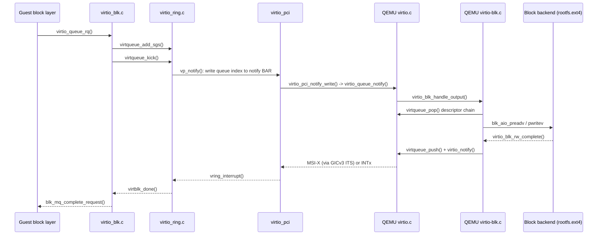

# Virtio Data Flow Cheat Sheet

This lab boots an arm64 guest on the QEMU `virt` machine (GICv3) with the root disk attached as `virtio-blk-pci`. The notes below follow one block request from the Linux guest into QEMU and back.



## 1. Device discovery and initialization

1. The guest enumerates the PCIe host bridge of the `virt` machine and finds a device with vendor ID `0x1af4`. Modern Virtio PCI device IDs are `0x1040 + virtio device ID`, so virtio-blk (ID `2`) appears as `0x1042`.
2. `virtio_pci` walks the vendor-specific PCI capabilities to locate the **common config**, **notify**, **ISR**, and **device-specific config** regions in the BARs.
3. The driver drives the status register through `ACKNOWLEDGE` → `DRIVER` → feature negotiation → `FEATURES_OK`.
4. For each virtqueue it allocates the **descriptor table**, **available ring**, and **used ring**, writes their guest-physical addresses to the common config, and reads `queue_notify_off`. The doorbell address is `notify_base + queue_notify_off * notify_off_multiplier`.
5. The driver sets `DRIVER_OK`; from here on the device may process queues.

## 2. Guest → QEMU (submitting a request)

1. `virtio_blk` turns a block request into a scatter-gather list: a `virtio_blk_outhdr` (type, sector), the data buffers, and a 1-byte status buffer.
2. `virtqueue_add_sgs()` writes those buffers' guest-physical addresses into a chain of descriptors and publishes the chain head in the available ring.
3. `virtqueue_kick()` checks event suppression (`VIRTIO_RING_F_EVENT_IDX` / `NO_NOTIFY`) and, if needed, `vp_notify()` writes the queue index to the notify doorbell.
4. The MMIO write traps into QEMU: `virtio_pci_notify_write()` → `virtio_queue_notify()` → the device's queue handler, `virtio_blk_handle_output()`.

> [!NOTE]
> On Linux/KVM hosts the doorbell is usually delivered through an ioeventfd to an IOThread. On macOS (TCG or HVF) there is no KVM ioeventfd, so the notify is handled synchronously on the vCPU thread — which makes the path easy to step through in a debugger.

## 3. QEMU → guest (completing a request)

1. `virtqueue_pop()` maps the descriptor chain into a `VirtQueueElement`; `virtio-blk` parses the header and issues async I/O to the block backend (`output/guest/rootfs.ext4`).
2. When I/O finishes, `virtio_blk_rw_complete()` writes the status byte, and `virtqueue_push()` adds a used element (descriptor head + bytes written) to the used ring.
3. `virtio_notify()` honors interrupt suppression and raises an MSI-X vector (routed through the GICv3 ITS) or falls back to INTx.
4. In the guest, `vring_interrupt()` invokes the queue callback `virtblk_done()`, which reads the used ring, completes the request, and frees the descriptors.

## 4. Observing the flow in this lab

Inside the guest (log in as `root`):

```sh
ls /sys/bus/virtio/devices/                    # virtio0 ...
cat /sys/bus/virtio/devices/virtio0/device     # 0x0002 = virtio-blk
cat /sys/bus/virtio/devices/virtio0/features   # negotiated feature bits
cat /proc/interrupts | grep virtio             # per-queue interrupt counts
```

From QEMU, enable trace events by adding them to the command in `scripts/run.sh`:

```sh
-trace 'virtio_queue_notify' -trace 'virtqueue_pop' -trace 'virtio_notify' \
-trace 'virtio_blk_handle_read' -trace 'virtio_blk_handle_write' -trace 'virtio_blk_rw_complete'
```

Or open the QEMU monitor with `Ctrl-a c` and run:

```text
info qtree
info virtio                       # lists virtio devices and their QOM paths
info virtio-status <path>         # status, features, and queues of one device
info virtio-queue-status <path> 0 # avail/used indices of queue 0
```

For a debugger, a good first breakpoint is `virtio_queue_notify()`, then follow it into `virtio_blk_handle_output()`.

## 5. Where to read the code

QEMU (`build/qemu/`, v9.2.0):

| File | What to look for |
|---|---|
| `hw/virtio/virtio-pci.c` | PCI capabilities, `virtio_pci_notify_write()`, MSI-X |
| `hw/virtio/virtio.c` | `virtqueue_pop()`, `virtqueue_push()`, `virtio_queue_notify()`, `virtio_notify()` |
| `hw/block/virtio-blk.c` | `virtio_blk_handle_output()`, request parsing, `virtio_blk_rw_complete()` |
| `include/hw/virtio/virtio.h` | `VirtIODevice`, `VirtQueue`, `VirtioDeviceClass` |

Linux (inside the Docker build volume, v6.12):

| File | What to look for |
|---|---|
| `drivers/virtio/virtio_pci_common.c` | `vp_notify()`, interrupt / vector setup |
| `drivers/virtio/virtio_pci_modern.c` | Modern transport: capability parsing, queue setup |
| `drivers/virtio/virtio_ring.c` | Split/packed rings, `virtqueue_add_sgs()`, `virtqueue_kick()`, `vring_interrupt()` |
| `drivers/block/virtio_blk.c` | `virtio_queue_rq()`, `virtblk_done()` |
| `include/uapi/linux/virtio_ids.h` | Assigned virtio device IDs |

## 6. Custom device in this lab

The custom device keeps the Virtio PCI transport and only replaces the device model: QEMU registers `virtio-custom-device`, and the Linux side is a `virtio_driver` (`guest-driver/virtio_custom.c`) that matches on the virtio device ID. Data flow is identical to the sections above; only `virtio_blk_handle_output()` is replaced by `virtio_custom_handle_output()`, which counts write requests and exposes the counter in config space. See [`patches/README.md`](../patches/README.md).

> [!WARNING]
> `struct virtio_device_id` matches the **virtio device ID**, not the PCI device ID. The current value `VIRTIO_ID_CUSTOM 0x105a` is actually a PCI ID: `0x105a - 0x1040 = 26`, which is the assigned ID of **virtio-fs**. Pick a virtio ID that is unused in both `include/uapi/linux/virtio_ids.h` and QEMU's `include/standard-headers/linux/virtio_ids.h`, use the same value on both sides, and expect the PCI device ID to be `0x1040 + ID`.

> [!IMPORTANT]
> The guest kernel is built with `# CONFIG_MODULES is not set`, so `virtio_custom.ko` cannot be loaded with `insmod`. Either build the driver into the kernel (add it to the kernel tree and rebuild with `build-guest-docker.sh`) or enable `CONFIG_MODULES` and build the module inside the Docker container, since the Linux tree now lives in the Docker volume rather than `build/linux`.
